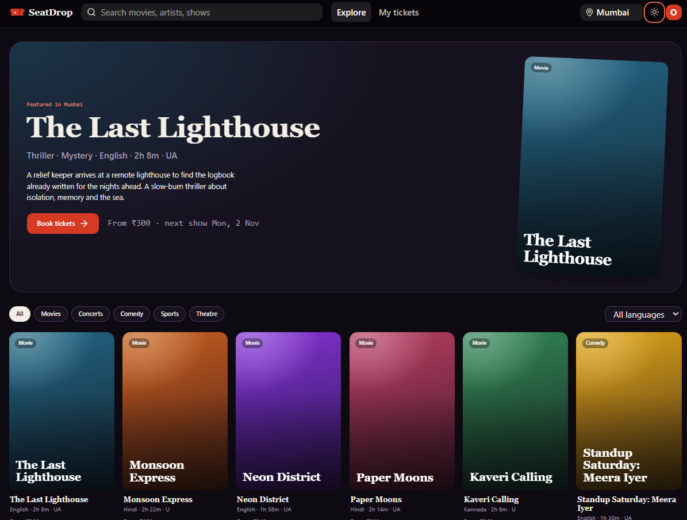
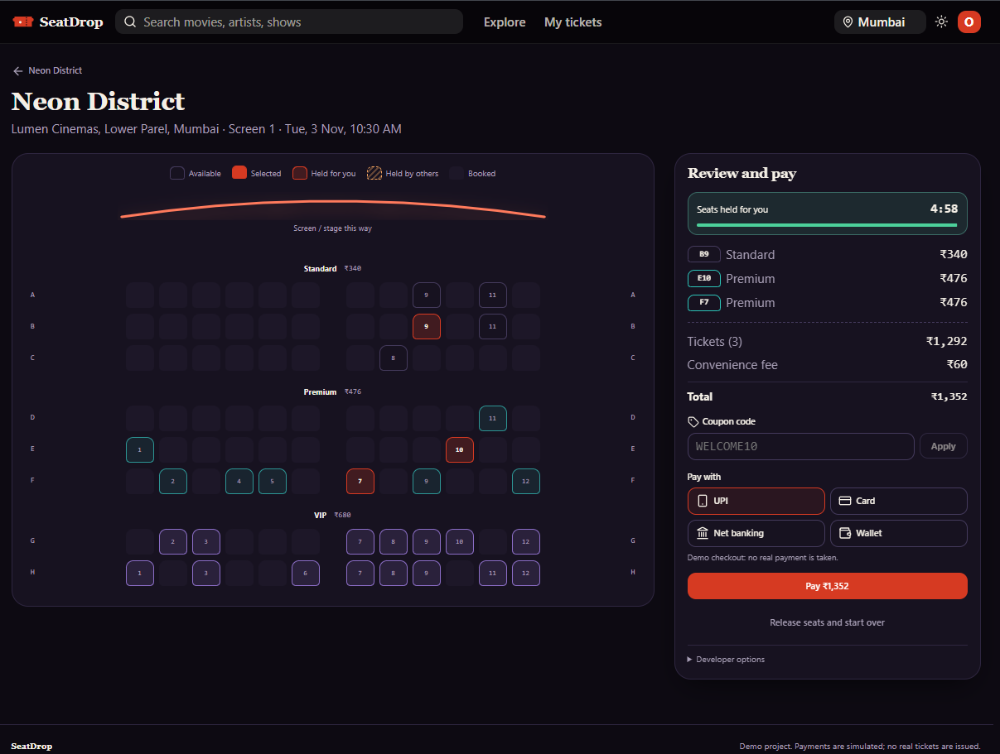
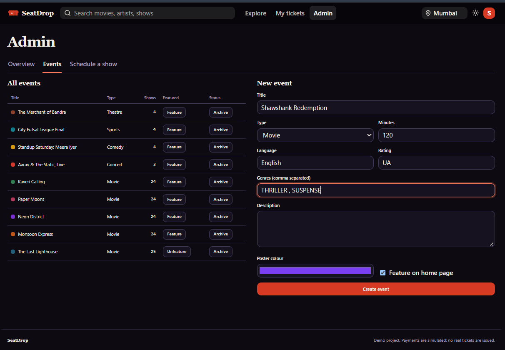
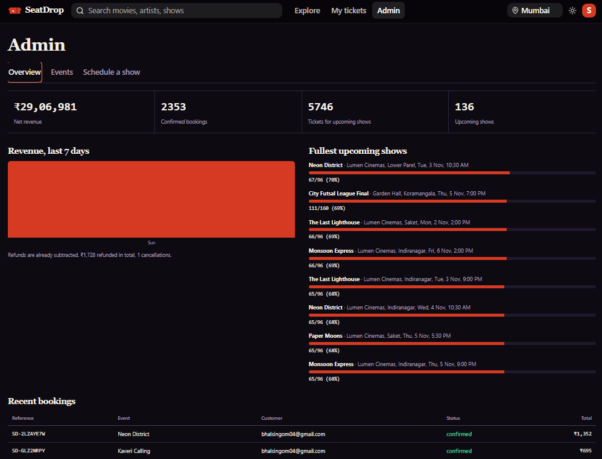
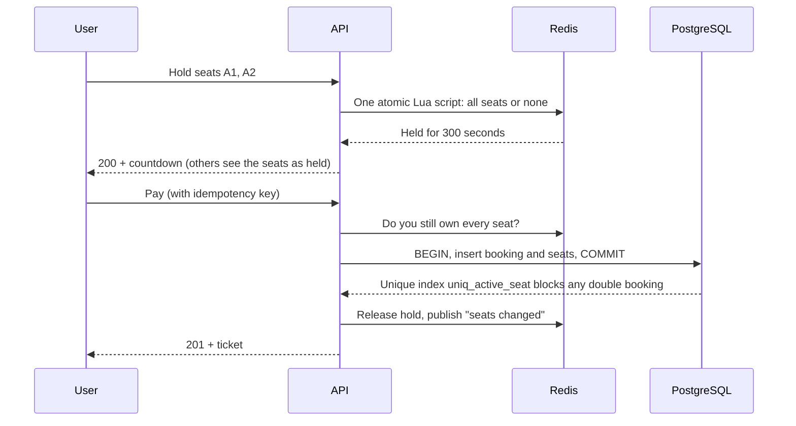

<div align="center">

# SeatDrop

**Book movies and live events on a live seat map that never sells the same seat twice.**


</div>
<p align="center">
  
</p>
<p align="center">
  
</p>
<p align="center">
  
</p>
<p align="center">
  
</p>


---

## What it is

SeatDrop is a full-stack ticket-booking platform for movies, concerts, comedy, sports and theatre. A visitor picks a city, chooses a showtime, selects seats on a live map, pays, and gets a ticket. An admin adds events, schedules shows and tracks sales.

- **Live seat map.** Seats turn held, booked or free for everyone in real time, with no page refresh.
- **5-minute seat hold.** Choosing seats reserves them while you pay. A countdown shows the time left, and the hold survives a page refresh.
- **Checkout you can trust.** Coupons, fees and totals are calculated on the server. Retrying a payment never charges twice.
- **Cancel with a clear refund.** The refund amount is shown before you confirm.
- **Admin tools.** Revenue overview, event management and a show scheduler that rejects overlapping shows.
- **Light and dark themes.** Follows your system on first visit, then remembers your choice. Works on phones and desktops.

## Why I built it

Ticketing looks simple until thousands of people want the same seat at the same moment. A naive "check if free, then book" lets two buyers both pass the check. SeatDrop is my answer to that problem: **when many users race for the same seat, exactly one wins, and the database refuses to record a double booking even if everything else goes wrong.**

## How it works



1. **Hold, in Redis.** A single Lua script checks every requested seat and claims all of them or none. Check and claim happen as one step, so no other request can slip in between.
2. **Confirm, in PostgreSQL.** The booking and its seats are written in one transaction. A partial unique index on `(show_id, seat_id)` for active seats means that even if a hold expires at exactly the wrong moment, the database rejects the second booking.
3. **Cancel.** Seats are marked inactive and become available to the next buyer.
4. **Live updates.** Every change is published through Redis pub/sub. Each API instance forwards it to its own browsers over Server-Sent Events, so the design scales beyond a single process.

### Proof under load

A script signs in 50 bot users and makes them all try to hold **the same seat at the same instant**. It runs once per hold strategy: the Redis Lua script (the default) and a PostgreSQL `FOR UPDATE NOWAIT` row lock, kept so the two approaches can be compared.

| Strategy | Concurrent users | Holds granted | Rejected (409) | Double holds |
| --- | :---: | :---: | :---: | :---: |
| Redis Lua script | 50 | **1** | **49** | **0** |
| PostgreSQL row lock | 50 | **1** | **49** | **0** |

The test only passes on exactly one `200` and forty-nine `409` responses.

## Tech stack

| Layer | Technology |
| --- | --- |
| Frontend | React 19, Vite, React Router, hand-written CSS with design tokens |
| Backend | Node.js, Express 5 |
| Data | PostgreSQL for bookings and the catalogue, Redis for holds, cache and pub/sub |
| Real time | Server-Sent Events |
| Auth and security | JWT, bcrypt, Helmet, CORS allowlist, rate limiting |

## Engineering decisions

- **The server owns the money.** Seat ids, prices, discounts, fees and refunds are recalculated on the server for every hold, quote and booking. The browser only displays them.
- **Idempotent payments.** Every checkout carries an idempotency key, so a retry after a network failure cannot charge twice.
- **Roles are never trusted from the token.** The user's role is re-read from the database on every request.
- **Abuse protection.** Rate limits on sign-in, seat holds and booking. Unknown-email logins take as long as wrong-password logins.
- **Fair refund policy, enforced in code.** 24 hours or more before the show refunds the full ticket price, 2 to 24 hours refunds half, and under 2 hours cannot be cancelled. The convenience fee is never refunded.
- **Pluggable payments.** The gateway is a stub in `paymentService.js`, ready to swap for Razorpay or Stripe.

## Getting started

**Prerequisites:** Node.js 20.19 or newer, a PostgreSQL database and a Redis server. Install them locally, or point `DATABASE_URL` and `REDIS_URL` at hosted ones.

```bash
# 1. API
npm install
cp .env.example .env          # then set JWT_SECRET (32+ random characters)
npm run db:init               # creates the tables and demo data
npm run dev                   # http://localhost:3000

# 2. Frontend (in a new terminal)
cd frontend
npm install
npm run dev                   # http://localhost:5174
```

Generate a secure secret:

```bash
node -e "console.log(require('crypto').randomBytes(48).toString('hex'))"
```

### Demo accounts

`npm run db:init` creates these:

| Role | Email | Password |
| --- | --- | --- |
| Admin | `admin@seatdrop.dev` | `Admin@12345` |
| Customer | `demo@seatdrop.dev` | `Demo@12345` |

Try the coupons `WELCOME10`, `WEEKEND20` and `FIRSTSHOW` at checkout. The seed data covers 3 cities, 9 events and about 150 upcoming shows, with some seats pre-booked so the maps look lived in. All sample titles are fictional.

### Configuration

| Variable | Required | Purpose |
| --- | --- | --- |
| `JWT_SECRET` | Yes | 32+ random characters. The API refuses to start without it. |
| `DATABASE_URL` | Yes | PostgreSQL connection string (or the individual `PG*` variables) |
| `REDIS_URL` | Yes | Redis connection string (or `REDIS_HOST` and `REDIS_PORT`) |
| `CLIENT_ORIGIN` | If the UI is on another origin | Comma-separated list of allowed origins |
| `PORT` | No | Defaults to `3000` |

### Useful commands

| Command | What it does |
| --- | --- |
| `npm run dev` | Start the API with auto-reload |
| `npm start` | Start the API |
| `npm run db:init` | Drop and recreate all tables, then seed. **Wipes data.** |
| `npm run test:concurrency` | Run the 50-user seat race |
| `cd frontend && npm run build` | Production build. The API serves `frontend/dist` automatically. |

### Run the concurrency test yourself

```bash
DISABLE_RATE_LIMIT=1 BCRYPT_ROUNDS=8 npm run dev     # terminal 1
npm run test:concurrency                              # terminal 2
```

## Project structure

```
seatdrop/
├── src/                          # API
│   ├── app.js                    # Express app, security, SSE
│   ├── config/                   # database and Redis clients
│   ├── middleware/               # auth, rate limiters
│   ├── routes/                   # auth, catalogue, shows, bookings, admin
│   ├── services/                 # seat holds, bookings, coupons, payments, realtime
│   ├── utils/                    # pricing and refund rules, validation
│   └── db/                       # schema, seed data
├── scripts/test-concurrency.js   # the 50-user race test
└── frontend/                     # React app (pages, components, hooks)
```

## Roadmap

- Real payment gateway (Razorpay or Stripe) with webhooks
- Email or SMS confirmation and a scannable QR ticket
- General-admission events and per-event seat layouts
- Automated tests for the booking flow
- Password reset by email

---

<div align="center">

Payments are simulated. Do not collect real card details until a real gateway is connected.

</div>
