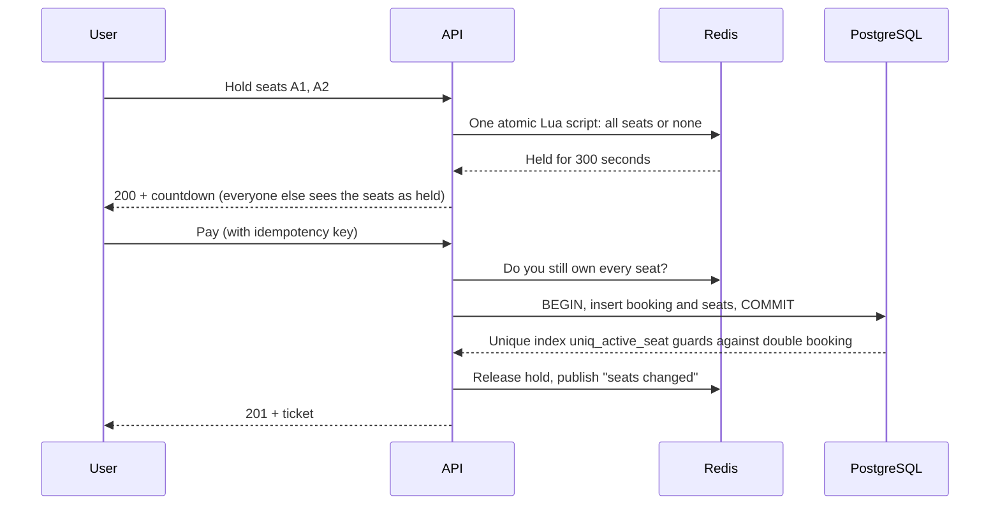

<div align="center">

# SeatDrop

**Book movies and live events with seat maps that never double-sell a seat.**


[Screenshots](#screenshots) · [Features](#features) · [How the seat engine works](#how-the-seat-engine-works) · [Getting started](#getting-started) · [API](#api-reference)

</div>

---

## Overview

SeatDrop is a ticket-booking platform for **movies, concerts, comedy, sports and theatre**. People browse by city, pick a showtime, choose seats on a live map, pay, and get a ticket. Admins add events, schedule shows and watch sales.

The interesting part is underneath: when thousands of people want the same seats at the same moment, **exactly one of them gets each seat**. Seat holds are atomic in Redis, and the database itself refuses a double booking as a last line of defence.

## Screenshots

<!--
  Save your three screenshots in docs/screenshots/ with these names, then delete this comment.
-->

<table>
  <tr>
    <td width="50%"></td>
    <td width="50%"></td>
  </tr>
  <tr>
    <td align="center"><sub><b>Explore.</b> Filter by city, type and language.</sub></td>
    <td align="center"><sub><b>Seat selection.</b> Live map, tiered pricing and a 5-minute hold.</sub></td>
  </tr>
</table>

<p align="center">
  
  <br />
  <sub><b>Your ticket.</b> Dark and light themes are both supported.</sub>
</p>

---

## Features

### For customers

| Feature                       | Details                                                                                                                                                                                       |
| ----------------------------- | --------------------------------------------------------------------------------------------------------------------------------------------------------------------------------------------- |
| **Browse by city**            | Movies, concerts, comedy, sports and theatre, with search, type and language filters.                                                                                                         |
| **Showtimes by venue**        | Pick a date, then a showtime. Each time shows the starting price and whether the show is filling fast or sold out.                                                                            |
| **Live seat map**             | Seats update for everyone as they are held, booked or released (Server-Sent Events, no page refresh). Aisle gap, curved screen, and Standard, Premium and VIP sections.                       |
| **5-minute seat hold**        | Picking seats reserves them for you while you pay. A countdown shows the time left, and the hold survives a refresh.                                                                          |
| **Up to 8 seats per booking** | Enforced on the server, not just the UI.                                                                                                                                                      |
| **Coupons**                   | Validated on the server (percent off, cap, minimum spend, expiry, usage limit). Try `WELCOME10`, `WEEKEND20`, `FIRSTSHOW`.                                                                    |
| **Payment step**              | UPI, card, net banking or wallet. The gateway is a stub in `paymentService.js`, ready to swap for Razorpay or Stripe.                                                                         |
| **Tickets**                   | Confirmation drawn as a ticket with a booking ID, seat chips and a printable view.                                                                                                            |
| **Cancel with refund**        | 24h or more before the show refunds the full ticket price, 2 to 24h refunds half, under 2h can't be cancelled. The convenience fee is never refunded. The refund is shown before you confirm. |
| **Safe retries**              | Every checkout carries an idempotency key, so a retried request never charges twice.                                                                                                          |
| **Light and dark themes**     | Follows your system on the first visit, then remembers your choice.                                                                                                                           |
| **Responsive**                | Top bar and bottom tab bar on phones, a sticky checkout bar on the seat page. Keyboard and screen-reader friendly seat buttons.                                                               |

### For admins

- **Overview:** net revenue (refunds subtracted), bookings, tickets sold, a 7-day revenue chart, the fullest upcoming shows and recent bookings.
- **Events:** create events with a poster colour, feature them on the home page, archive or restore them.
- **Schedule:** add a show on any screen. End time comes from the event's duration, and overlapping shows on the same screen are rejected.

### Under the hood

- JWT auth with bcrypt, and roles re-read from the database on every request.
- Rate limits on sign-in, seat holds and booking, plus Helmet headers and a CORS allowlist.
- Prices, fees, discounts and refunds are **always calculated on the server**. The browser only displays them.
- Redis read-through cache for static show details.

---

## How the seat engine works



1. **Hold (Redis).** One Lua script checks every requested seat and claims them all, or claims none. There is no gap between "check" and "set" for another request to slip into. Starting a new hold replaces your previous one for that show.
2. **Confirm (PostgreSQL).** The booking and its seats are written in one transaction. A **partial unique index** (`uniq_active_seat` on `show_id, seat_id` where the seat is active) means that even if a hold expired at exactly the wrong moment, the database would reject the second booking.
3. **Cancel.** Seats are flagged inactive, which frees them for the next buyer.
4. **Live updates.** Every change publishes to Redis pub/sub. Each API instance forwards it to its own browsers over Server-Sent Events, so it scales past a single process.

Two hold strategies are included so you can benchmark them (`?strategy=redis` is the default; `?strategy=postgres` takes a `FOR UPDATE NOWAIT` row lock first).

### Load test

```bash
DISABLE_RATE_LIMIT=1 BCRYPT_ROUNDS=8 npm run dev     # terminal 1
npm run test:concurrency                              # terminal 2
```

50 signed-in bot users try to hold the **same seat** at the same instant, once per strategy. A pass means exactly one `200` and 49 `409`s. Record your own numbers here:

| Strategy            | Users | Time          | Holds granted | Conflicts | Double holds |
| ------------------- | ----- | ------------- | ------------- | --------- | ------------ |
| Redis Lua script    | 50    | _your result_ | 1             | 49        | 0            |
| PostgreSQL row lock | 50    | _your result_ | 1             | 49        | 0            |

---

## Tech stack

| Layer    | Technology                                                                            |
| -------- | ------------------------------------------------------------------------------------- |
| Frontend | React 19, Vite, React Router, Sonner, Lucide, hand-written CSS with design tokens     |
| Backend  | Node.js 18+, Express 5                                                                |
| Data     | PostgreSQL (bookings, catalogue), Redis (holds, cache, pub/sub)                       |
| Auth     | JWT, bcryptjs                                                                         |
| Type     | Fraunces (headings), Hanken Grotesk (body), IBM Plex Mono (seats, prices, references) |

## Project structure

```
seatdrop/
├── src/                         # API
│   ├── app.js                   # Express app, security, SSE bootstrap
│   ├── config/                  # db.js, redis.js
│   ├── middleware/              # auth, rate limiters
│   ├── routes/                  # auth, catalog, shows, bookings, admin
│   ├── services/                # showService (holds), bookingService, catalogService,
│   │                            # couponService, paymentService, realtime, adminService
│   ├── utils/                   # pricing and refund policy, references, validation
│   └── db/                      # schema.sql, seed.js, initDb.js
├── scripts/test-concurrency.js  # 50-user race test
└── frontend/                    # React app
    └── src/
        ├── pages/               # Home, EventDetail, ShowPage, Bookings, BookingDetail, Auth, Admin
        ├── components/          # Navbar, SeatMap, OrderPanel, Ticket, Poster, Dialog ...
        ├── hooks/               # useShowStream (SSE), useCountdown
        └── utils/               # api client, theme store, city store, formatters, auth context
```

---

## Getting started

**Prerequisites:** Node.js 20.19+ (the frontend needs it), a PostgreSQL database and a Redis server. Install them locally, or point `DATABASE_URL` and `REDIS_URL` at hosted ones.

```bash
# 1. API
npm install
cp .env.example .env          # set JWT_SECRET (32+ random characters)
npm run db:init               # creates tables and demo data
npm run dev                   # http://localhost:3000

# 2. Frontend (new terminal)
cd frontend
npm install
npm run dev                   # http://localhost:5174
```

Generate a secret:

```bash
node -e "console.log(require('crypto').randomBytes(48).toString('hex'))"
```

### Demo accounts

`npm run db:init` prints these:

| Role     | Email                | Password      |
| -------- | -------------------- | ------------- |
| Admin    | `admin@seatdrop.dev` | `Admin@12345` |
| Customer | `demo@seatdrop.dev`  | `Demo@12345`  |

Change them with `SEED_ADMIN_PASSWORD` and `SEED_DEMO_PASSWORD` before deploying anywhere public.

### What gets seeded

3 cities (Mumbai, Delhi, Bengaluru) with 6 venues and 9 screens, 9 events across all five types, around 150 shows over the next six days, seats pre-booked at random so the maps look lived in, and three coupons. The sample titles are fictional.

### Environment variables

| Variable                                                                   | Required                   | Description                                                 |
| -------------------------------------------------------------------------- | -------------------------- | ----------------------------------------------------------- |
| `JWT_SECRET`                                                               | Yes                        | 32+ random characters. The API refuses to start without it. |
| `DATABASE_URL` or `PGHOST`, `PGPORT`, `PGUSER`, `PGPASSWORD`, `PGDATABASE` | Yes                        | PostgreSQL connection                                       |
| `REDIS_URL` or `REDIS_HOST`, `REDIS_PORT`                                  | Yes                        | Redis connection                                            |
| `PORT`                                                                     | No                         | Defaults to `3000`                                          |
| `CLIENT_ORIGIN`                                                            | If UI is on another origin | Comma-separated allowed origins                             |
| `TRUST_PROXY`                                                              | Behind a proxy             | Set to `1`                                                  |
| `DISABLE_RATE_LIMIT`                                                       | Load test only             | Set to `1`                                                  |

### Scripts

| Command                        | Purpose                                                                                     |
| ------------------------------ | ------------------------------------------------------------------------------------------- |
| `npm run dev`                  | API with auto-reload                                                                        |
| `npm start`                    | API                                                                                         |
| `npm run db:init`              | **Drops and recreates** all tables, then seeds (needs `--force` when `NODE_ENV=production`) |
| `npm run test:concurrency`     | 50-user race test                                                                           |
| `cd frontend && npm run build` | Production build. The API serves `frontend/dist` automatically if it exists.                |

---

## API reference

All routes live under `/api`. Errors are `{ "error": "message" }`.

<details>
<summary><b>Auth and catalogue</b></summary>

| Method | Endpoint                           | Access | Purpose                             |
| ------ | ---------------------------------- | ------ | ----------------------------------- |
| POST   | `/auth/register`                   | Public | Create an account, returns a token  |
| POST   | `/auth/login`                      | Public | Sign in                             |
| GET    | `/auth/me`                         | User   | Current user                        |
| GET    | `/cities`                          | Public | Cities with venues                  |
| GET    | `/events?city=&kind=&q=&language=` | Public | Events with upcoming shows          |
| GET    | `/events/:id?city=`                | Public | Event and its shows with seats left |

</details>

<details>
<summary><b>Seats, holds and bookings</b></summary>

| Method | Endpoint                                   | Access                  | Purpose                                                                                     |
| ------ | ------------------------------------------ | ----------------------- | ------------------------------------------------------------------------------------------- |
| GET    | `/shows/:id`                               | Public                  | Show details (cached)                                                                       |
| GET    | `/shows/:id/seats`                         | Public (optional token) | Seat map. With a token it also marks your own held seats and returns your hold's time left. |
| GET    | `/shows/:id/stream`                        | Public                  | Server-Sent Events: a nudge whenever seats change                                           |
| POST   | `/shows/:id/hold?strategy=redis\|postgres` | User                    | Hold 1 to 8 seats for 5 minutes                                                             |
| DELETE | `/shows/:id/hold`                          | User                    | Release your hold                                                                           |
| POST   | `/shows/:id/quote`                         | User                    | Price breakdown with optional `coupon_code`                                                 |
| POST   | `/bookings`                                | User                    | Confirm and pay. Needs `payment_ref` (idempotency key) and `payment_method`.                |
| GET    | `/bookings`, `/bookings/:id`               | User                    | Your bookings                                                                               |
| POST   | `/bookings/:id/cancel`                     | User                    | Cancel with refund per policy                                                               |

</details>

<details>
<summary><b>Admin</b></summary>

| Method    | Endpoint            | Purpose                                       |
| --------- | ------------------- | --------------------------------------------- |
| GET       | `/admin/stats`      | Revenue, bookings, occupancy, recent bookings |
| GET, POST | `/admin/events`     | List or create events                         |
| PATCH     | `/admin/events/:id` | Feature, archive or restore                   |
| GET       | `/admin/screens`    | Screens for the schedule form                 |
| POST      | `/admin/shows`      | Schedule a show                               |

</details>

---

## Deployment

One free-tier setup that works end to end (check each provider's current limits before relying on it):

| Part            | Host                    | Notes                                                                                                            |
| --------------- | ----------------------- | ---------------------------------------------------------------------------------------------------------------- |
| API and website | Render web service      | One process serves the API and the built React app, so there is no CORS to configure and live updates just work. |
| PostgreSQL      | Neon (free)             | Does not expire. Use the **pooled** connection string.                                                           |
| Redis           | Render Key Value (free) | Same region as the web service. Seat holds are lost if it restarts, which is fine for a demo.                    |

1. Push the repo to GitHub.
2. Create a Neon project and copy its connection string (it ends in `?sslmode=require`).
3. In Render choose **New, Blueprint**, pick the repo, and paste the Neon string when asked for `DATABASE_URL` (or create the two services by hand using the build and start commands in `render.yaml`).
4. Seed the hosted database once, from your own machine:

   ```bash
   DATABASE_URL="<neon string>" SEED_ADMIN_PASSWORD="<strong password>" SEED_DEMO_PASSWORD="<another>" npm run db:init
   ```

5. Open the Render URL and sign in as the admin.

Free web services sleep after 15 minutes without traffic and take about a minute to wake, so open the site before a demo. `npm run db:init` wipes all data, so run it only once. To add more demo shows later without wiping anything, run `DATABASE_URL="<neon string>" npm run db:extend`.

---

## Security notes

- Passwords are bcrypt-hashed, and unknown-email logins take the same time as wrong-password logins.
- The user is always taken from the token. The client never sends a user id.
- Seat ids, prices, discounts and totals are re-validated on the server for every hold, quote and booking.
- Rate limits protect sign-in, seat holds and booking.
- The token lives in `localStorage`, which is common for single-page apps but exposed if the site ever has an XSS bug. Move it to an HTTP-only cookie if you harden this for production.
- Payments are simulated. Do not collect real card details until a real gateway is wired in.

## Roadmap

- [ ] Real payment gateway (Razorpay or Stripe) with webhooks
- [ ] Email or SMS confirmation and a scannable QR ticket
- [ ] General-admission events (no seat map) and per-event seat layouts
- [ ] Automated tests for the booking flow
- [ ] Password reset by email

---

<div align="center">

Built to show how a ticketing system stays correct under load.

</div>
